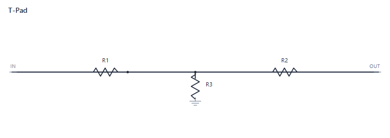
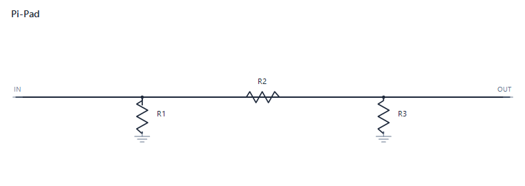
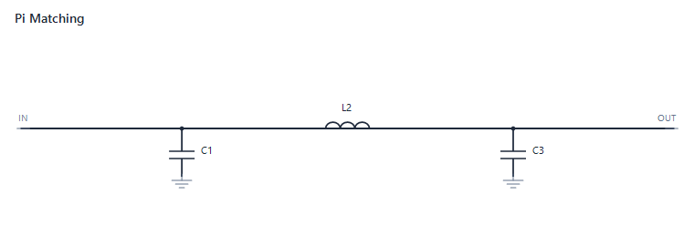
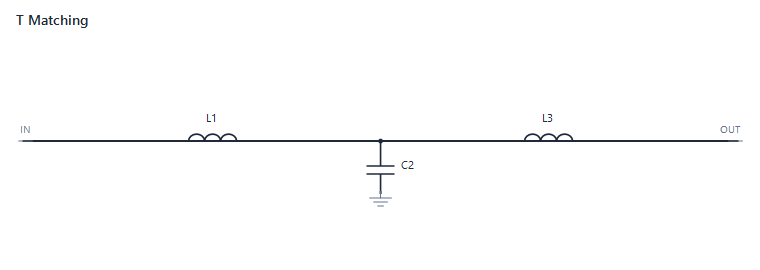
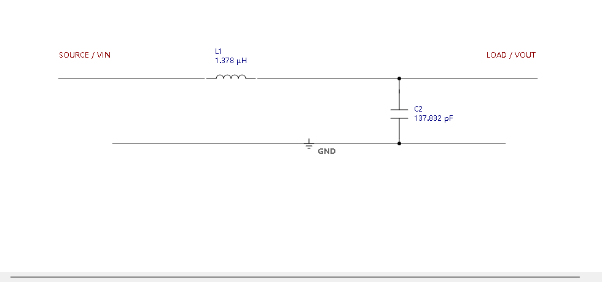
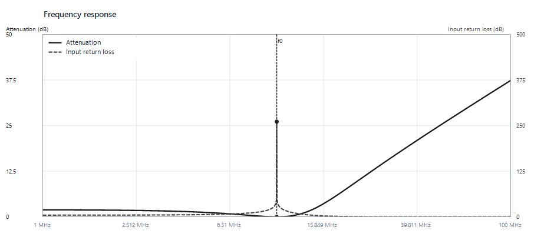
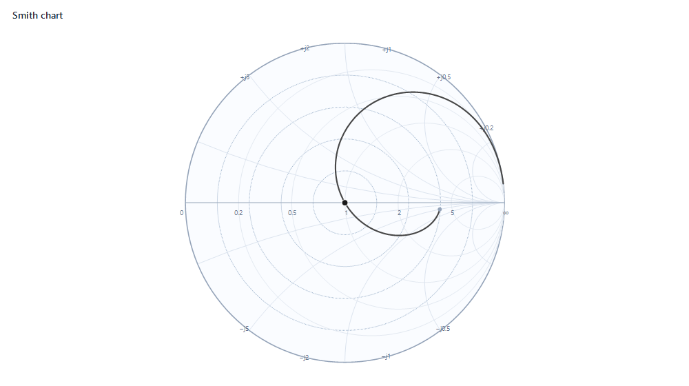

# Signal Attenuation & Impedance Matching

The fourth first-class design module in Circuit Module Designer. It synthesizes only passive R/L/C networks, produces a real `CircuitGraph`, and verifies the final graph independently before allowing export.

## Modes

| Mode | Purpose | Primary topologies |
|---|---|---|
| Attenuation | Controlled loss with matched or unequal ports | T-pad, Pi-pad, resistive L-pad, cascaded T-pads |
| Impedance Matching | Single-frequency conjugate match using LC networks | L (four positions), Pi (LP/HP/mixed), T (LP/HP/mixed) |

## Supported topology matrix

### Resistive attenuation

- Matched T-pad and Pi-pad for equal port resistances.
- Unequal-impedance T-pad and Pi-pad solved with a bounded positive-value Newton solver.
- Minimum-loss L-pad for unequal ports. The L-pad loss is fixed by the impedance ratio; it is not treated as a free attenuation setting.
- Cascaded matched T-pad stages for high attenuation / reduced resistor stress.
- 0 dB bypass only for equal port resistances. A direct link cannot match unequal ports, so unequal 0 dB is rejected.
- Minimum realizable loss is enforced. For example, 50 Ω → 25 Ω at 6 dB is rejected because it is below the physical matched-pad minimum; 8 dB is feasible.

### LC matching

- L networks in all four positions:
  - Series L + Shunt C
  - Series C + Shunt L
  - Shunt C + Series L
  - Shunt L + Series C
- A shunt-at-input L form is only valid when the source is the high-resistance side; a shunt-at-output form requires the load to be the high side. Invalid positions are rejected instead of silently swapped.
- Low-pass and high-pass Pi/T using a virtual intermediate resistance and two L-section solves.
- Mixed-reactance Pi/T networks (four elements) are supported when `Allow mixed reactance` is enabled and the resulting network is verified.
- Real and complex ports: enter `R` and optional `X @ f0`. The port model is fixed `R+jX` over the sweep, so it is a single-frequency model.
- Design Q is a synthesis choice. Loaded Q is calculated separately from the final frequency sweep; the two are not treated as the same number.

## Mathematics and verification

- **Two-port / nodal analysis**: final performance uses a complex MNA solve with explicit source and load terminations at every frequency.
- **Transducer gain**: `GT = Pload / Pavs`, with `Pavs = |Vs|²/(4·Re(Zs))` for an RMS Thevenin source.
- **Attenuation / insertion loss**: reported as `-10·log10(GT)` under the specified terminations.
- **Matched-port attenuation**: separately reported as `-20·log10(|S21|)` for real reference impedances.
- **Return loss**: conjugate power-wave reference `Γ = (Zport − Zref*)/(Zport + Zref)`; VSWR is reported only when the reference is real.
- **S parameters**: S11, S21 and S22 computed from a separate real-reference solve; S12 is left N/A when not required by the module.
- **Bandwidth**: continuous band around the design frequency satisfying input/output return-loss and insertion-loss gates. The local sweep is dense enough not to collapse a narrow match to a single sample; sweep-boundary limitations are reported.
- **Power**: resistor dissipation is calculated from the solved node voltages; passive power conservation is checked.
- **Standard values**: Continuous, E12, E24, E48 and E96. E-series optimization evaluates every bounded combination of actual selected values and re-verifies the complete network; the ideal solution is never used as the claimed standard-value performance.
- **ESR / inductor Q**: when enabled, series parasitic resistors are added to the final CircuitGraph and therefore enter MNA, verification, reports and SPICE export.
- **Independent verification**: `AttenuationMatchingCircuitVerifier` reads only the final graph, validates component types/ranges/topology/connectivity, reruns the MNA and sweep, checks hard constraints and stale/cached metrics, and assigns Supported/Warning/Failed with structured diagnostics.

## Wizard

1. **Select Design Mode** — two modes: Attenuation or Impedance Matching.
2. **Source & Load Configuration** — R and Reactance directly, VNA import (`S1P` / `S2P` Touchstone) in each port, signal level, design frequency, sweep range/points/type.
3. **Performance Requirements** — attenuation/error/return-loss/power or matching/bandwidth requirements, optimization objective.
4. **Network Topology** — automatic/manual selection, family/response/Q, actual topology preview, unsupported combinations disabled.
5. **Component Selection & Optimization** — value mode, R/C/L ranges, ESR/Q, dissipation, search budget.
6. **Candidate & Verification** — one page with the ranked candidates, verification status, filter-style tabs (`Schematic`, conditional `Analysis`/`Smith Chart`, `Components`, `SPICE Netlist`, `Design Report`) and export actions. Attenuation is pure resistor, so it has no frequency-response or Smith tabs.

Changing any parameter marks the previous result stale and blocks export until recalculation.

## VNA import\n\n- Each port has an **Import VNA...** button.\n- Supported files: Touchstone `.s1p` and `.s2p`, with `RI`, `MA` or `DB` data and Hz/kHz/MHz/GHz frequency units.\n- The selected reflection coefficient is interpolated at the current design frequency and converted with `Z = Z0 (1+Γ)/(1−Γ)`. No extrapolation is performed.\n- `.s1p` uses S11; `.s2p` uses S11 for the load and S22 for the source.\n- The imported R and X are written directly into the two port fields; non-zero X automatically selects Impedance Matching.\n\n## SPICE

Two netlists are produced:

- **Design netlist**: only the passive network and its `VIN`/`VOUT` ports.
- **Testbench netlist**: the design network plus explicit source and load R/L/C equivalents, `V_SRC`, and the AC analysis.

Source/load impedance is never added twice (as a graph element and as an exporter option). LTspice output omits `.PRINT`; Multisim/Berkeley retain it.

## Tests

- 5 module regression tests integrated in the 149-test suite.
- 300-point deterministic matrix: [CSV](../../artifacts/SignalAttenuationMatching/300-point-matrix.csv).
  - 100 attenuation points across port values and attenuation targets.
  - 100 L-matching points across impedance ratios/frequencies.
  - 100 Pi/T matching points across families, responses and design Q values.
- Representative checks include 50Ω→50Ω 3/6 dB T-pads, 75Ω→50Ω unequal pads, 50Ω→200Ω LC matching, 50Ω→1kΩ at 100 MHz (about 346.9 nH / 6.94 pF), complex source/load, mixed Pi, and ESR/Q-enabled designs.

## Known limitations

- Only ideal lumped R/L/C is the baseline. Optional ESR/Q is a series-resistance approximation, not a full vendor model.
- Custom `R+jX` ports are held constant over the sweep; they are single-frequency models. Use Series R-L/R-C when broadband physical behavior matters.
- No transmission lines, microstrip, PCB electromagnetic simulation, or distributed matching.
- No transformer matching, baluns, or vendor-specific matching ICs.
- No Monte Carlo or tolerance-yield analysis.
- Matching bandwidth is bounded by the finite sweep and the stated thresholds.
- LTspice `.asc` coordinate export is not provided.
- A resistive pad cannot cancel complex port reactance; use the Impedance Matching mode.
- Fully differential and multi-port networks are outside v1.
## Visuals

The topology preview uses real resistor/inductor/capacitor symbols rather than generic boxes. The T-pad is drawn as series–shunt–series, the Pi-pad as shunt–series–shunt, and LC previews use L/C symbols with the correct low-pass/high-pass/mixed positions.

| T-pad | Pi-pad |
|---|---|
|  |  |
| Pi LC match | T LC match |
|  |  |

The actual schematic is generated from the final `CircuitGraph` layout, with junction dots, a ground rail and source/load port labels:

Frequency response uses separate left/right dB axes so a 200 dB return-loss trace does not flatten the attenuation curve. The Smith chart includes constant-resistance circles, constant-reactance arcs, dotted |Γ| circles, the Γin locus and a design-frequency marker. Hovering a curve or Smith chart displays a compact cursor readout; circuit schematics and topology previews intentionally have no cursor readout. The Smith tab is shown only when the sweep produces a meaningful locus; a perfectly matched resistive pad has Γ≈0 and no Smith tab is displayed.

