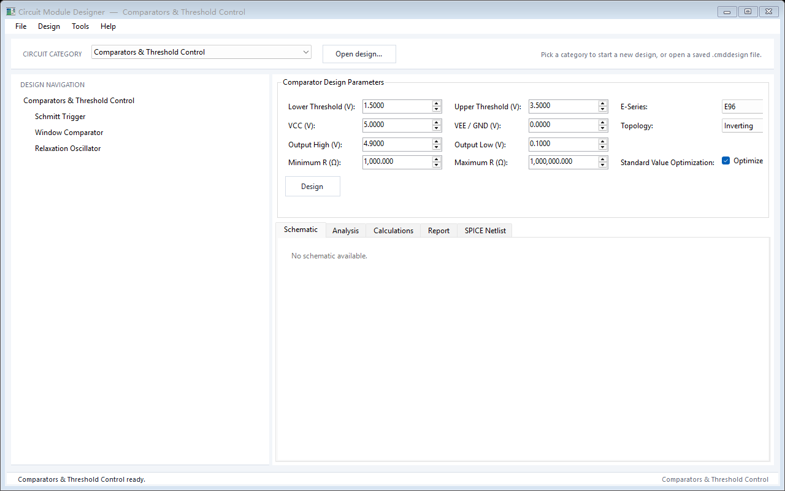

# Circuit Module Designer

一个面向模拟电路模块设计的 Windows 桌面工具：从设计指标出发，完成拓扑/参数综合、标准值选型、CircuitGraph 生成、独立验证、分析绘图、原理图、SPICE 网表和 HTML/JSON 报告。

当前版本：**V0.0（既有模块冻结）**。本版本在保持既有三个模块行为不变的前提下，新增第四个“信号衰减与阻抗匹配”模块；既有模块只做缺陷修复和可靠性/文档整理。


---

## 1. 项目已经完成了什么

V0 已经打通了四个模拟设计模块的完整闭环：

1. **输入设计指标**：滤波器、精密模拟运算、比较器/振荡器、信号衰减与阻抗匹配分别有专用向导。
2. **自动综合与选型**：拓扑选择、方程求解、E12/E24/E48/E96 标准值优化、器件范围检查。
3. **生成最终电路**：统一输出 `CircuitGraph`（元件、引脚、网络、参数），而不是只给公式。
4. **独立验证**：从最终电路重新做 MNA/阈值/工作点/动态验证，不信任综合阶段的中间结果。
5. **分析与可视化**：AC/DC/瞬态响应、Bode 图、比较器传输特性、振荡器时域波形、原理图布局。
6. **导出与归档**：
   - LTspice / Multisim / Generic Berkeley SPICE 文本网表；
   - HTML 设计报告；
   - JSON 设计快照；
   - `.cmddesign` 设计归档文件。
7. **桌面应用外壳**：分类选择、导航树、统一主题、菜单、状态栏、设置持久化、设计文件查看器。

当前自动化回归：**149 个测试全部通过**。另有 150 点比较器矩阵、500 点精密模拟矩阵、100 点张弛振荡器矩阵、300 点信号衰减/匹配矩阵等独立测试资料。

---

## 2. 项目结构

```text
CircuitModuleDesigner/
├─ Program.cs                         # WinForms 入口
├─ CircuitModuleDesigner.csproj       # net10.0-windows，无第三方 NuGet 依赖
│
├─ Core/                              # 与具体模块无关的基础设施
│  ├─ Circuit/                        # CircuitGraph、元件、引脚、网络、Builder、校验
│  │  └─ Spice/                       # SPICE 序列化、导出选项、LTspice/Multisim 适配
│  ├─ Analysis/                       # 通用 AC 分析模型与服务
│  ├─ Schematic/                      # 原理图文档、几何、连线、符号库
│  │  └─ Symbols/                     # 元件符号定义与目录
│  ├─ Engineering/                    # 工程数值格式化（SI 单位、有效数字）
│  └─ Reporting/                      # 共享 JSON 报告选项
│
├─ Modules/
│  ├─ Filters/FilterDesign/           # 滤波器设计模块
│  │  ├─ Approximation/               # Butterworth / Chebyshev I / Bessel / 表格化原型
│  │  ├─ Design/                      # 设计请求、规格归一化、阶数计算
│  │  ├─ Engines/                     # 顶层设计引擎
│  │  ├─ Sections/                    # 二阶节/一阶节分解
│  │  ├─ Gain/                        # 级联增益分配
│  │  ├─ Synthesis/                   # Sallen-Key、MFB、Bainter、RC、LC、标准值
│  │  │  ├─ SallenKey/
│  │  │  ├─ PassiveLc/
│  │  │  ├─ Bainter/
│  │  │  └─ Verification/             # 基于 MNA 的节传输验证
│  │  ├─ Topology/                    # 节装配、拓扑检查、位号分配
│  │  ├─ Validation/                  # 规格、器件范围、最终设计验证、支持矩阵
│  │  ├─ Analysis/                    # 滤波器响应与规格符合性
│  │  ├─ Schematic/                   # 布局模板、正交布线、碰撞检测
│  │  ├─ Reports/                     # HTML/JSON 报告
│  │  ├─ Services/                    # SPICE 导出、手工测试行
│  │  ├─ Controls/                    # 分步向导、预览、原理图、输出页
│  │  └─ Models/ Enums/
│  │
│  ├─ PrecisionAnalogComputing/       # 精密模拟运算模块
│  │  ├─ Engines/                     # 顶层设计引擎
│  │  ├─ Models/                      # 请求、结果、能力、二极管/运放约束
│  │  ├─ Synthesis/                   # 仿射网络、分段电路、结型电路、动态电路
│  │  ├─ Validation/                  # 仿射/分段/结型/动态验证、运放可行性、工作包络
│  │  ├─ Analysis/                    # 仿射扫描、动态时域、Bode
│  │  ├─ Schematic/                   # 原理图布局
│  │  ├─ Reporting/                   # HTML/JSON 报告
│  │  ├─ Services/                    # SPICE 导出、手工测试行
│  │  └─ Controls/                    # 向导、传输特性、动态波形
│  │
│  ├─ Comparators/                    # 比较器与阈值控制模块
│  │  ├─ Engines/                     # Schmitt / Window / Relaxation Oscillator
│  │  ├─ Validation/                  # 请求校验、最终 CircuitGraph 验证
│  │  ├─ Analysis/                    # 传输特性、振荡器时域
│  │  ├─ Schematic/                   # 原理图布局
│  │  ├─ Reporting/                   # HTML/JSON 报告
│  │  ├─ Services/                    # SPICE 导出、手工测试行
│  │  ├─ Controls/                    # 比较器向导、波形控件
│  │  └─ Models/
│  │
│  └─ SignalAttenuationMatching/      # 信号衰减与阻抗匹配模块
│     ├─ Models/ Enums/               # 请求、候选、指标、端口阻抗
│     ├─ Engines/                     # 设计引擎、候选选择
│     ├─ Synthesis/                   # 电阻 pad、L/Pi/T、组合、标准值优化
│     ├─ Topology/                    # 拓扑规格、CircuitGraph 构建
│     ├─ Analysis/                    # 二端口/MNA、阻抗、带宽、S 参数
│     ├─ Validation/                  # 请求、拓扑、独立最终电路验证
│     ├─ Schematic/                   # 布局与 SVG
│     ├─ Reporting/ Services/         # HTML/JSON、SPICE、快照
│     └─ Controls/                    # 六步向导、图表、Smith 图
│
├─ Forms/                             # 主窗口、设置、帮助、设计文件查看器、主题
├─ Services/                          # 应用信息、设置存储、设计文档、模块宿主接口
├─ Models/                            # AppSettings、DesignDocument
├─ Controls/                          # 通用 UI 基础设施、字段尺寸计算
│
├─ Tests/CircuitModuleDesigner.CoreTests/
│  ├─ Program.cs                      # 控制台测试/回归入口（149 个测试）
│  └─ CircuitModuleDesigner.CoreTests.csproj
│
├─ NetlistSamples/LTspice/            # 可人工检查的 .cir 样例
├─ artifacts/                         # UI 截图、测试矩阵、审计结果
└─ 审计/设计文档（NETLIST_AUDIT.md、PRECISION_ANALOG_COMPUTING_AUDIT.md 等）
```

**分层原则**：`MainForm` 只依赖 `IDesignModuleHost`，不引用任何模块的请求/结果类型；每个模块自己拥有引擎、验证、分析、原理图、导出和 UI。这样外壳不会随着模块增加而膨胀。

---

## 3. 核心技术

### 3.1 统一电路模型：CircuitGraph

所有模块最终都落到同一个电路表示：

- `CircuitGraph`：元件集合 + 网络集合；
- `CircuitComponent`：引用号、类型、参数；
- `CircuitPin` / `CircuitNet`：引脚与网络的连接关系；
- `ComponentFactory` / `CircuitBuilder`：以受控方式构造元件和连接；
- `ComponentParameterNames`：参数键的统一约定；
- `CircuitGraphValidator`：接地、重复引用、网络完整性等检查。

这样做的好处是：原理图、SPICE、报告和验证都消费同一个最终电路，而不是各自解释一套中间数据。

### 3.2 设计流水线

```text
DesignRequest
    → 规格校验 / 可行性评估
    → 近似原型或拓扑选择
    → 方程求解 / 节综合
    → 标准值优化（E12/E24/E48/E96）
    → CircuitGraph 装配与校验
    → 独立验证（MNA / 阈值 / 工作点 / 动态）
    → 分析、原理图、SPICE、HTML/JSON 报告
    → .cmddesign 归档
```

关键点是：**综合和验证分离**。验证器只读最终 `CircuitGraph`，重新计算传输、阈值或工作点；综合阶段的公式不能直接“自证正确”。

### 3.3 独立验证

- **滤波器**：`CircuitSectionMnaVerifier` 对最终节做 MNA 传输测量；`FilterDesignVerifier` 再做整链规格符合性检查。
- **精密模拟**：`AffineDesignVerifier`、`PiecewiseOperationVerifier`、`JunctionOperationVerifier`、`DynamicOperationVerifier` 分别验证线性、分段、结型和动态运算；另有 `OpAmpFeasibilityEvaluator`、`OperatingEnvelopeEvaluator`。
- **比较器**：`ComparatorCircuitVerifier` 从最终图重新求阈值、振荡频率和占空比。

所有模块都区分 `Supported` / `Warning` / `Failed`，失败时给出具体原因和建议，而不是输出看似可用的假设计。

### 3.4 标准值与工程数值

- 滤波器、精密模拟、比较器共享 E 系列选型思路，但各自保留模块特定的约束（Q 误差、增益、阈值、频率/占空比）。
- 数值统一使用 `InvariantCulture` 和科学计数法，保证 SPICE 与报告在 `de-DE` 等区域设置下不会出现逗号小数点。
- `EngineeringValueFormatter` 负责 SI 前缀和可读单位。

### 3.5 原理图生成

- 元件符号目录与符号定义（`Core/Schematic/Symbols`）；
- 模块级布局服务（滤波器有 Sallen-Key/MFB/Passive LC 布局模板）；
- 正交布线、避障、碰撞检测、连线去重；
- 最终生成 `SchematicDocument`，由 WinForms 控件绘制。

### 3.6 SPICE 导出

统一的 `CircuitGraphSpiceSerializer` + 适配器：

- `LtspiceNetlistExporter`；
- `MultisimNetlistExporter`；
- `CircuitSpiceExporter`（Generic Berkeley）。

支持 R/C/L、独立电压/电流源、E 受控源、二极管 `.MODEL`、运放外部 `.SUBCKT`/`.INCLUDE`、`.AC/.DC/.TRAN/.OP`、`.PARAM`、`.LIB`、`.TEMP`。按方言处理 `.PRINT`：LTspice 不支持该指令，因此 LTspice 文本网表省略 `.PRINT` 并给出注释；Multisim/Berkeley profile 保留 `.PRINT`。

### 3.7 报告与归档

- `ReportJson` 统一 HTML/JSON 报告的 JSON 规则：缩进、字符串枚举、允许 `NaN/Infinity`、宽松转义。
- HTML 报告是自包含的，可直接浏览器打开或应用内预览。
- `.cmddesign` 是小信封格式：

```json
{
  "schema": "CircuitModuleDesigner.Design.v1",
  "application": "Circuit Module Designer",
  "appVersion": "0.0",
  "savedAtUtc": "2026-10-20T...",
  "category": "Comparators",
  "module": "Comparators & Threshold Control",
  "summary": "…",
  "snapshotJson": "{ … }",
  "netlist": "…"
}
```

外壳只依赖这层信封，因此可以查看任意模块保存的设计。当前“Open Design”打开的是**只读设计查看器**，不会把参数恢复回可编辑向导。

### 3.8 无源衰减/匹配技术

- 电阻 T/Pi/L pad 闭式/数值综合；
- LC L/Pi/T 匹配：解析初值 + 正实值 Newton；
- Pi/T 使用虚拟中间电阻与两个 L 节，最终按整网 MNA 验证；
- 标准值全组合评估；
- 复端口、S 参数、回波损耗、VSWR、匹配带宽、电阻耗散。

### 3.9 UI 基础设施

- `UiTheme`：统一调色板、字体、按钮、菜单渲染；
- `IDesignModuleHost`：外壳与模块之间的最小契约（标题、HasDesign、快照、摘要、网表、Calculate、导航解绑）；
- `AppSettingsStore`：窗口位置/大小、导航栏/状态栏、退出确认、最近分类等持久化；
- `UiFieldMetrics`：按最大值自动计算数字框宽度、按最长项计算下拉框宽度，避免文字被截断。

---

## 4. 模块一：滤波器设计（Filters）

### 支持范围

| 维度 | 支持 |
|---|---|
| 模式 | Active / Passive，单端 |
| 响应 | Low-Pass / High-Pass / Band-Pass / Band-Stop |
| 近似 | Butterworth、Chebyshev Type I、Bessel、Gaussian to 6 dB、Gaussian to 12 dB、Linear Phase 0.05°、Linear Phase 0.5° |
| 有源实现 | Sallen-Key（LP/HP/BP）、Multiple Feedback（LP/HP/BP）、Bainter Notch（BS） |
| 无源实现 | 一阶 RC（LP/HP）、双拐点 RC Band-Pass、Twin-T Notch、双端接 LC 梯形 |
| 阶数 | 自动计算或指定阶数 |
| 标准值 | E12 / E24 / E48 / E96，可按频率误差或 Q 误差优化 |
| 边界条件 | 源/负载电阻、LC 端接策略/方向、器件范围、目标增益 |

### 主要能力

- 自动阶数计算与手工阶数校验；
- 低通到高通/带通/带阻的频率变换；
- 二阶节分解、级联增益分配、节 Q/增益可行性检查；
- Sallen-Key、MFB、Bainter、Passive LC 的闭式/数值综合；
- LC 双端接插入损耗原型、正实性/Cauer 提取、端接比处理；
- 标准值优化后仍要求最终电路通过整链规格验证；
- 自动生成原理图、SPICE、HTML/JSON 报告；
- 支持手工测试行导入/回填（`FilterManualTestRowService`）。

### 明确的 V0 边界

- 全差分滤波器尚未实现；
- 有源带阻只支持 Bainter Notch，Sallen-Key/MFB 的 Band-Stop 不支持；
- Passive RC 只覆盖一阶/双拐点/Twin-T 拓扑，不追求陡峭原型响应；
- LC 只支持双端接（doubly terminated）路径，Ideal Voltage Source 单端接模式不支持；
- Bessel LC 的指定阶数限定 1–6；
- Gaussian/Linear Phase LC 只支持表格中通过正实性/重构审计的阶数；
- 某些带宽/阻抗组合会因器件范围、端接比或标准值精度被明确拒绝（并给出替代建议）。

---

## 5. 模块二：精密模拟运算（Precision Analog Computing）

### 支持的 8 类运算

| 运算 | 说明 |
|---|---|
| General Linear Combination | 多输入加权求和 + 输出偏置，支持 1–8 路输入、正负系数 |
| Voltage Range Mapper | 输入范围到输出范围的仿射映射 |
| Precision Half-Wave Rectifier | 正/负半波，增益可设，可选理想/结型二极管 |
| Precision Full-Wave Rectifier | 正/负输出极性，增益可设 |
| Logarithmic Amplifier | 基于匹配结的 `Vout ∝ -ln(Vin/Vref)` |
| Exponential Amplifier | 基于匹配结的 `Vout ∝ exp(Vin/S)` |
| Practical Integrator | 带泄漏/下限拐点的积分器 |
| Practical Differentiator | 带上限拐点的微分器 |

### 主要能力

- 供电轨 VCC/GND/VEE、输出摆幅/裕量约束；
- 运放有限 GBW、压摆率、开环增益等可行性检查；
- 电阻/电容范围、E12/E24/E48/E96 标准值、偏置补偿；
- 仿射网络、分段整流、结型对数/指数、动态积分/微分的独立综合器；
- 最终电路的操作特定验证（DC 传输、分段导通、结电流/电压域、动态频响/时域）；
- 传输特性图、Bode 图、动态波形；
- 自动原理图、SPICE、HTML/JSON 报告；
- 支持手工测试行。

### 明确的 V0 边界

- 精密整流器的静态验证使用理想开关分段模型；不宣称真实二极管反向恢复/交越瞬态精度；
- Log/Antilog 假设匹配结、等温和给定 Shockley 参数；不覆盖失配、自热、温度梯度、封装寄生；
- 运放是抽象约束模型，不替代厂商宏模型；动态模块提供 GBW/压摆率门槛，但不做完整非线性运放瞬态；
- 部分极端增益/频率/器件范围组合会被明确判为不可行。

---

## 6. 模块三：比较器与阈值控制（Comparators）

### 6.1 Schmitt Trigger

- 反相/同相拓扑；
- 正/负/双电源；
- 零迟滞与任意迟滞；
- 自动阈值/反馈电阻综合；
- 最终电路阈值独立验证；
- 传输特性、原理图、SPICE、报告。

### 6.2 Window Comparator

- InsideWindowHigh / OutsideWindowHigh 输出模式；
- 上下阈值、边界迟滞；
- 两个比较器 + 饱和组合器；
- 最终电路四边界（lower falling/rising、upper falling/rising）验证；
- 传输特性、原理图、SPICE、报告。

### 6.3 Relaxation Oscillator

- 目标频率 + 占空比（20%–80%）；
- 推挽输出；
- 自动放置 1/3 输出摆幅的迟滞窗口；
- 自动选择定时 RT/CT，支持 E24/E48/E96；
- 由最终电路反算实际频率/占空比；
- 时域波形、原理图、瞬态 SPICE、报告；
- **100 点测试矩阵**：10 频率 × 10 电源/占空比组合，50 点标准值优化 + 50 点连续值。

测试结果：**100/100 通过验收，99 Pass + 1 E24 标准值 Warning，0 Failed**。最大频率误差 2.579%，最大占空比误差 0.471 个百分点。详见 [测试说明](artifacts/RelaxationOscillator/README.md) 和 [原始 CSV](artifacts/RelaxationOscillator/relaxation-oscillator-100.csv)。

### 明确的 V0 边界

- 张弛振荡器只支持推挽输出；
- 使用理想零延迟比较器模型，不包含传播延迟、失调、偏置电流、噪声；
- E24/E48 的标准值网格较粗，频率误差超过 2% 但仍在系列窗口内时给出 Warning；
- 不做真实比较器宏模型/PCB 寄生级仿真。

---

## 7. 模块四：信号衰减与阻抗匹配（Signal Attenuation & Impedance Matching）

### 支持的设计模式

| 模式 | 目标 | 主要拓扑 |
|---|---|---|
| Attenuation | 等/不等阻抗的受控衰减 | T-Pad、Pi-Pad、L-Pad、级联 T-Pad |
| Impedance Matching | 单频最大功率传输/阻抗变换 | LC L（4 种串并联位置）、Pi（LP/HP/Mixed）、T（LP/HP/Mixed） |

### 关键实现

- 纯无源 R/L/C，不依赖运放、比较器或衰减器 IC；
- 50Ω→50Ω 3/6/10 dB、75Ω↔50Ω 不等阻抗、0 dB bypass、不可实现衰减判断；
- 50Ω→200Ω LC 匹配、50Ω→1kΩ@100MHz 解析基准、复源/复负载；
- E12/E24/E48/E96 全网络标准值优化；
- ESR/电感 Q 启用时，将串联寄生电阻真正加入最终 CircuitGraph；
- 独立 MNA 验证、S11/S21/S22、回波损耗、VSWR、匹配带宽、电阻耗散；
- 独立的 Design Netlist 与含源/负载的 Testbench Netlist；
- 六步 Wizard；候选与验证合并在同一页，含候选表、频率响应图、按数据条件显示的 Smith 图、原理图、HTML/JSON 报告和 `.cmddesign` 保存。

详细说明见 [模块 README](Modules/SignalAttenuationMatching/README.md) 和 [设计与审计说明](Modules/SignalAttenuationMatching/DESIGN.md)。

## 8. 应用外壳

- 分类选择：Precision Analog、Filters、Comparators；
- 左侧模块导航树 + 右侧工作区；
- 菜单：
  - File：New / Open / Save / Save As / Exit
  - Design：Calculate（F5）/ Reset Parameters
  - Tools：Settings
  - Help：User Guide（F1）/ About
- 状态栏：当前模块、操作状态；
- 设置持久化到 `%LOCALAPPDATA%\CircuitModuleDesigner\settings.json`；
- `.cmddesign` 保存/打开，打开为只读设计查看器；
- 统一 `UiTheme`，无深色标题带；窗口标题为 `Circuit Module Designer — <module>`。



---

## 9. 构建、运行与测试

### 环境

- Windows 10/11
- .NET 10 SDK（`net10.0-windows`）
- 无第三方 NuGet 包

### 构建与运行

```powershell
dotnet build CircuitModuleDesigner.csproj
dotnet run --project CircuitModuleDesigner.csproj
```

如果应用正在运行，`bin\Debug\net10.0-windows\CircuitModuleDesigner.exe` 会被锁定，先关闭应用再构建。

### 运行回归测试

测试是控制台 harness，不是 `dotnet test`：

```powershell
dotnet build Tests\CircuitModuleDesigner.CoreTests\CircuitModuleDesigner.CoreTests.csproj
.\Tests\CircuitModuleDesigner.CoreTests\bin\Debug\net10.0-windows\CircuitModuleDesigner.CoreTests.exe
```

当前结果：**149 tests passed**。

也可以按名称过滤：

```powershell
.\Tests\CircuitModuleDesigner.CoreTests\bin\Debug\net10.0-windows\CircuitModuleDesigner.CoreTests.exe "Relaxation oscillator"
```

### 手工测试行模式

```powershell
.\Tests\CircuitModuleDesigner.CoreTests\bin\Debug\net10.0-windows\CircuitModuleDesigner.CoreTests.exe --run-filter-rows input.txt output.txt
```

---

## 10. 测试与审计资料

| 资料 | 内容 |
|---|---|
| [100 点振荡器测试](artifacts/RelaxationOscillator/README.md) | 覆盖范围、结果、E24 限制说明 |
| [300 点信号衰减/匹配矩阵](artifacts/SignalAttenuationMatching/300-point-matrix.csv) | 衰减、L 匹配、Pi/T 匹配的确定性结果 |
| [振荡器 CSV](artifacts/RelaxationOscillator/relaxation-oscillator-100.csv) | 100 行请求/实际/误差/RT/CT/状态 |
| [150 点比较器矩阵](artifacts/Comparator_150_TestPoints.txt) | 比较器测试点 |
| [比较器结果](artifacts/Comparator_150_RESULTS.txt) | 对应结果 |
| [500 点精密模拟矩阵](artifacts/PrecisionAnalogComputing_500_TestPoints.txt) | 精密模拟测试点 |
| [精密模拟结果](artifacts/PrecisionAnalogComputing_500_RESULTS_FINAL_ROUND.txt) | 对应结果 |
| [信号衰减/匹配审计](SIGNAL_ATTENUATION_MATCHING_AUDIT.md) | 模块实现、拓扑矩阵、149 测试、300 点矩阵、已知限制 |
| [信号衰减/匹配设计说明](Modules/SignalAttenuationMatching/DESIGN.md) | 架构、数学、验证规则、支持矩阵 |
| [网表审计](NETLIST_AUDIT.md) | SPICE 方言、`.PRINT`、运放/二极管策略、未支持项 |
| [精密模拟审计](PRECISION_ANALOG_COMPUTING_AUDIT.md) | 架构、数学、验证、性能、已知限制 |
| [UI 性能审计](UI_PERFORMANCE_AUDIT.md) | 设计调用链、渲染性能、已知问题 |
| [LTspice 网表样例](NetlistSamples/LTspice/) | RC 低通、二极管整流、外部运放子电路 |

---

## 11. V0 冻结说明与后续方向

- **既有三个模块已冻结**：V0 能力、界面和数据格式保持稳定；本版本新增第四个信号衰减/匹配模块，既有模块只做缺陷修复、文档和测试补充。
- **暂不实现**：电源环路补偿器（此前讨论过，明确延后）、全差分滤波器、更多有源拓扑、厂商运放/二极管模型自动选择、PCB/寄生级仿真。
- **明确不做**：生成 LTspice `.asc` 原理图坐标；对未知供应商加密模型作跨仿真器兼容承诺；把抽象运放当作真实器件宏模型。
- 仓库中的 `功放模块设计草案.md` 是后续方向的草案，不属于 V0 已实现功能。

---

## 12. 一句话总结

**Circuit Module Designer V0 是一个“从指标到可验证电路”的模拟模块设计工作台**：它不只算公式，而是把设计落实成统一电路图，再用独立验证、原理图、SPICE 和报告把结果交付出来。
